## Part 1.
### 1.1. Сети и маски
1. Определить адрес сети 192.167.38.54/13

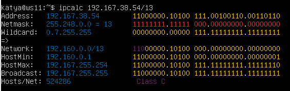  
 адрес сети с помощью ipcalc

2. Перевод маски 255.255.255.0 в префиксную и двоичную запись, /15 в обычную и двоичную, 11111111.11111111.11111111.11110000 в обычную и префиксную.

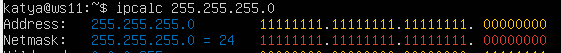  
255.255.255.0 в двоичной записи (в префиксной /24)

  
/15 в обычной и двоичной

  
11111111.11111111.11111111.11110000 в обычной и префиксной

3. Минимальный и максимальный хост в сети 12.167.38.4 при масках: /8, 11111111.11111111.00000000.00000000, 255.255.254.0 и /4

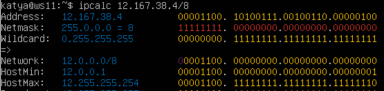  
при маске /8

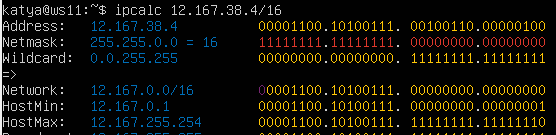  
при маске 11111111.11111111.00000000.00000000 (/16)

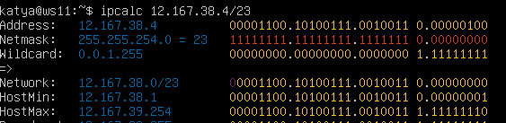  
при маске 255.255.254.0 (/23)

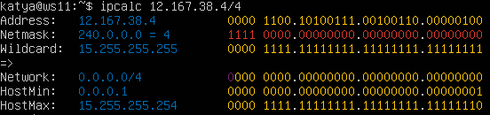  
при маске /4

### 1.2. localhost

1. Можно ли обратиться к приложению, работающему на localhost, со следующими IP: 194.34.23.100, 127.0.0.2, 127.1.0.1, 128.0.0.1
- 194.34.23.100 - нет 
- 127.0.0.2 - да
- 127.1.0.1 - да
- 128.0.0.1 - нет
(Диапазон IP-адресов для localhost — 127.0.0.1–127.255.255.255)

### 1.3. Диапазоны и сегменты сетей

1. Какие из перечисленных IP можно использовать в качестве публичного, а какие только в качестве частных: 10.0.0.45, 134.43.0.2, 192.168.4.2, 172.20.250.4, 172.0.2.1, 192.172.0.1, 172.68.0.2, 172.16.255.255, 10.10.10.10, 192.169.168.1
- 10.0.0.45 - частный
- 134.43.0.2 - публичный
- 192.168.4.2 - частный
- 172.20.250.4 - частный
- 172.0.2.1 - публичный
- 192.172.0.1 - публичный
- 172.68.0.2 - публичный
- 172.16.255.255 - частный
- 10.10.10.10 - частный
- 192.169.168.1 - публичный

2. Какие из перечисленных IP-адресов шлюза возможны у сети 10.10.0.0/18: 10.0.0.1, 10.10.0.2, 10.10.10.10, 10.10.100.1, 10.10.1.255

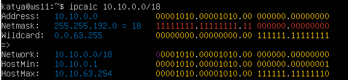  
минимальный и максимальный хост для сети 10.10.0.0/18

- из перечисленных возможны 10.10.0.2, 10.10.10.10, 10.10.1.255.

## Part 2. Статическая маршрутизация между двумя машинами

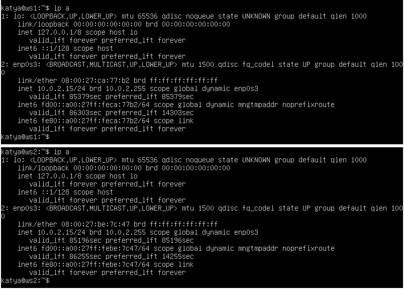  
вывод команды ip a на ws1 и ws2

- внутренней сети соответствует интерфейс enp0s3 на обеих виртуальных машинах с внутренним адресом 10.0.2.15/24

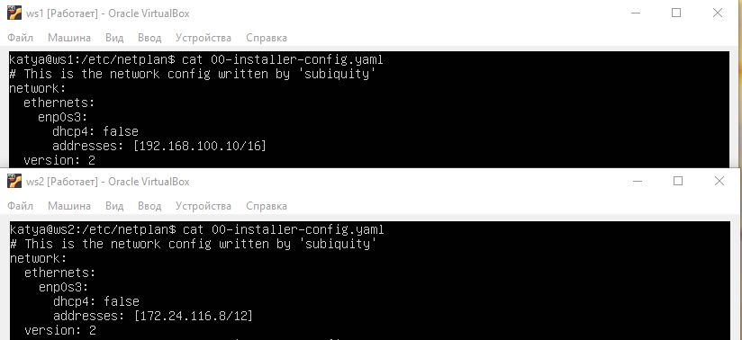
заданы указанные в задании ip адреса 

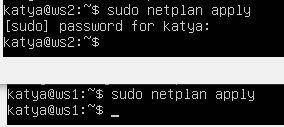    
выполнена команда netplan apply

### 2.1. Добавление статического маршрута вручную

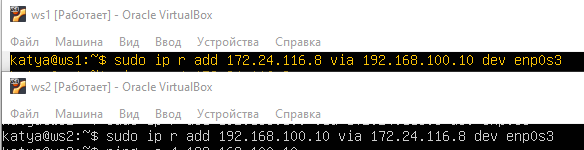    
добавлены статические маршруты с помощью ip r add

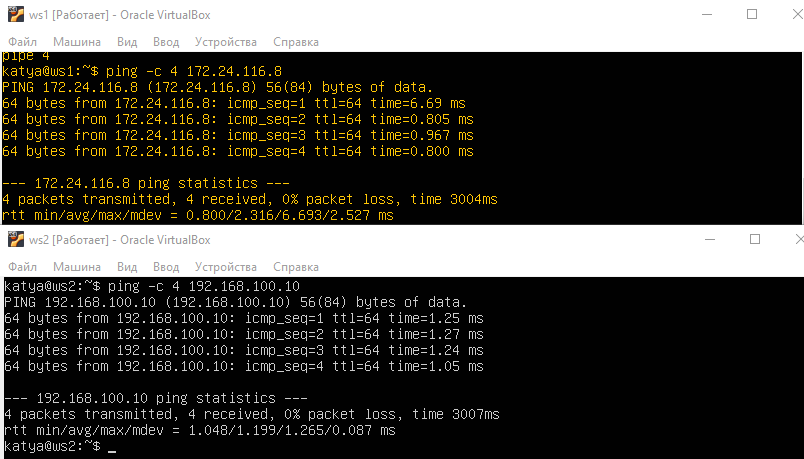    
ping добавленных статические маршруты 

### 2.1. Добавление статического маршрута с сохранением

    
перезапуск виртуальных машин

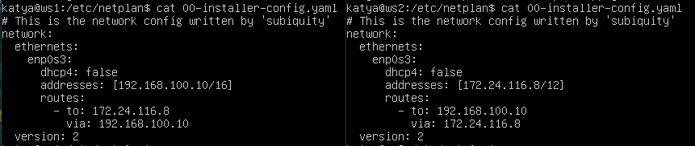    
маршруты в файле /etc/netplan/00-installer-config.yaml

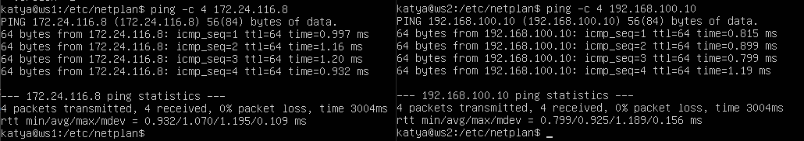    
ping в ws1 и ws2

## Part 3. Утилита iperf3

### Part 3.1. Скорость соединения

-  8 Mbps это 1 MB/s
- 100 MB/s это 800000 Kbps
- 1 Gbps это 1000 Mbps

### Part 3.1. Утилита iperf3

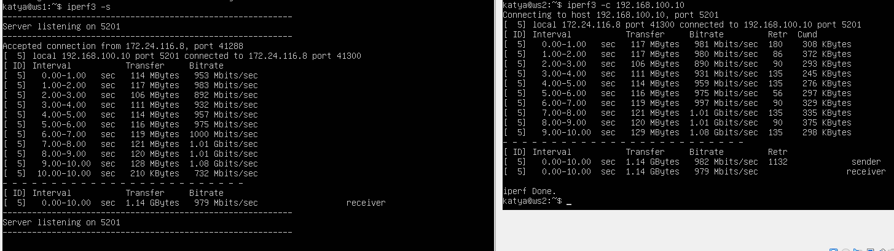    
скорость соединения между ws1 и ws2 с помощью iperf3

## Part 4. Сетевой экран

### 4.1. Утилита iptables

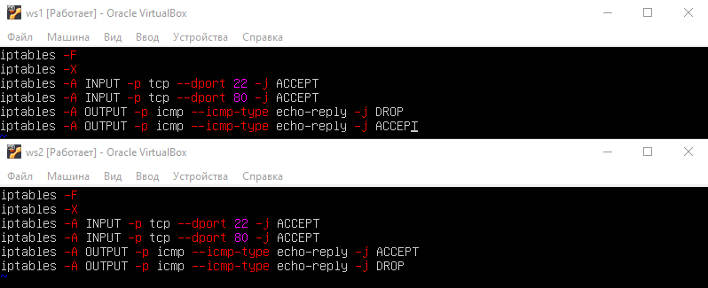    
добавлены правила в файл /etc/firewall.sh

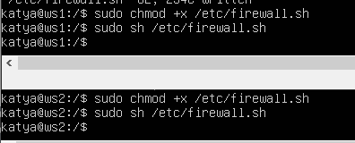    
выполнение указанных команд 

- разница в том, что если указаны аналогичные команды, то работает первое указанное правило. Поэтому ws2 может отправлять пакеты данных, (его можно пропинговать с ws1), а ws1 нет. 

### 4.2. Утилита nmap

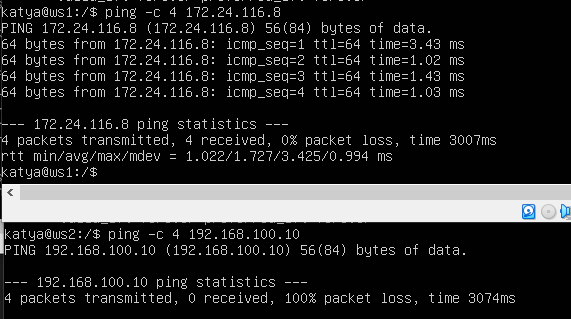    
команда ping 

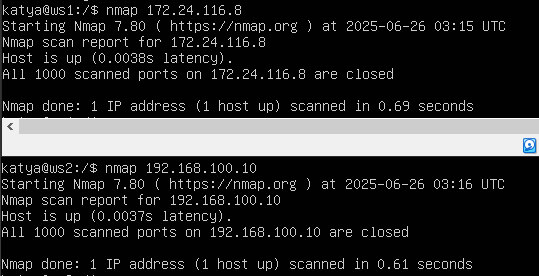    
команда nmap

## Part 5. Статическая маршрутизация сети

### 5.1. Настройка адресов машин

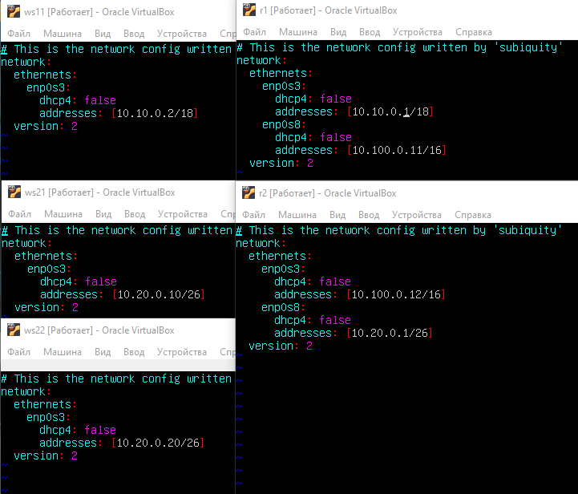    
Содержание файла etc/netplan/00-installer-config.yaml всех виртуальных машин.

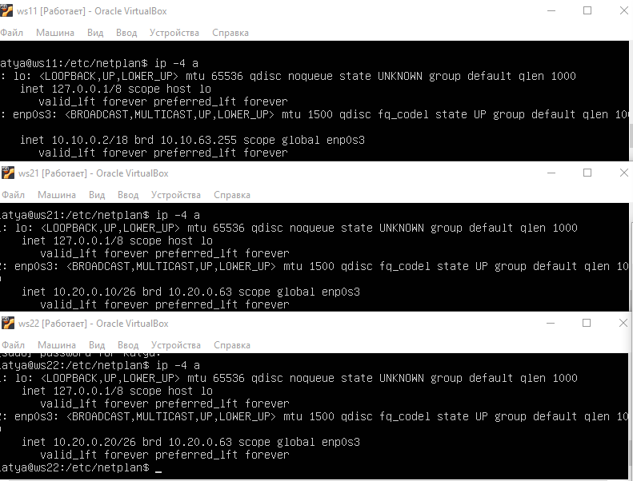    
ip -4 a ws11, ws21, ws22.

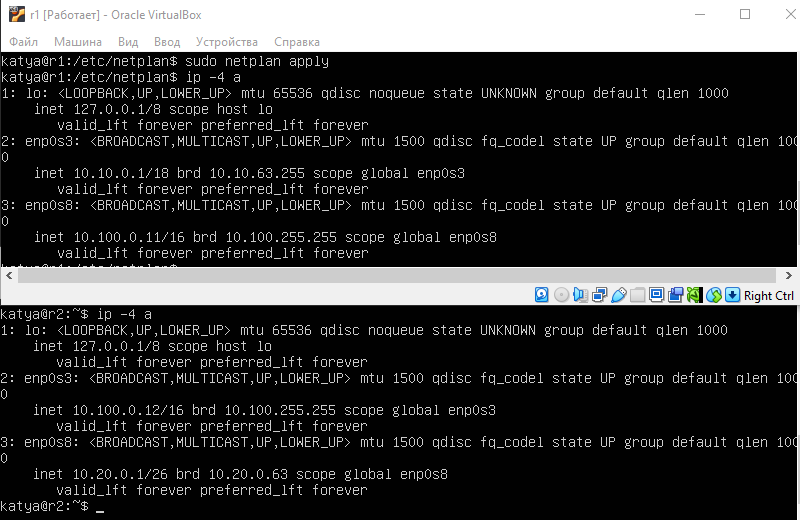    
ip -4 a r1, r2.

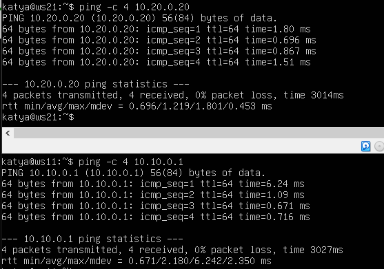    
Ping ws22 с ws21 и r1 с ws11.

 ### 5.2. Включение переадресации IP-адресов

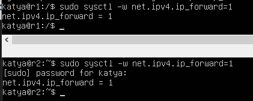    
Команда sysctl -w net.ipv4.ip_forward=1 на r1, r2.

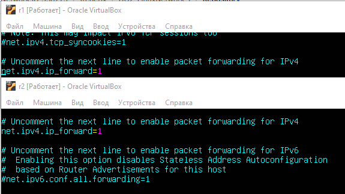    
Cодержание изменённого файла /etc/sysctl.conf r1, r2.

 ### 5.3. Установка маршрута по умолчанию

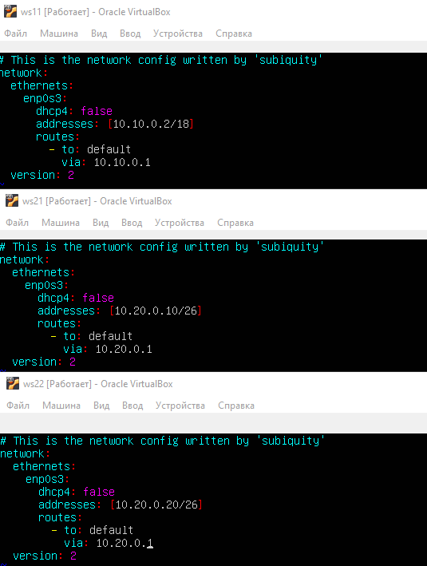    
Cодержание файла etc/netplan/00-installer-config.yaml для рабочих станций.

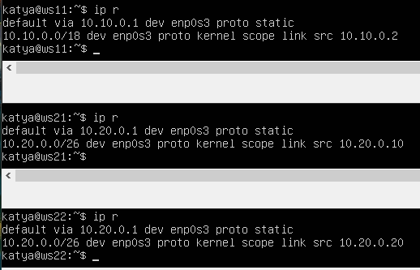    
ip r на рабочих станциях.

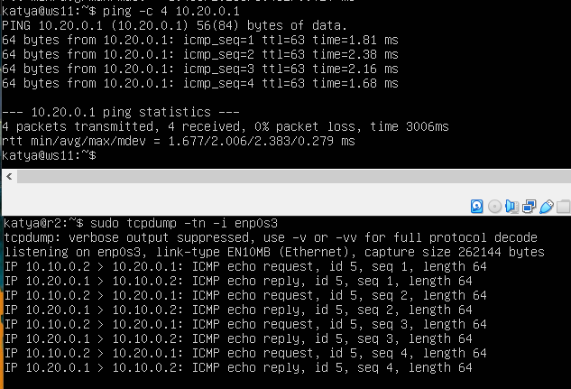    
ping с ws11 > r2 и команда tcpdump -tn -i (интерфейс).

### 5.4. Добавление статических маршрутов

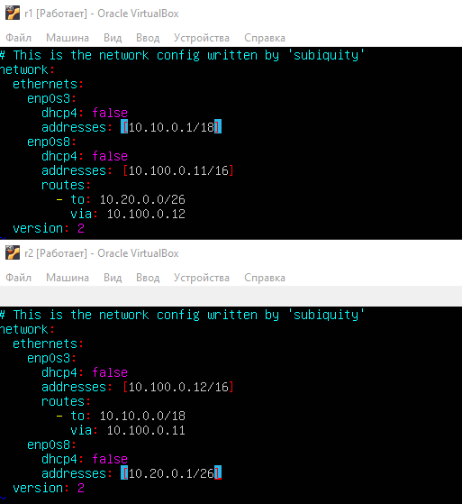    
Файл etc/netplan/00-installer-config.yaml для каждого роутера.

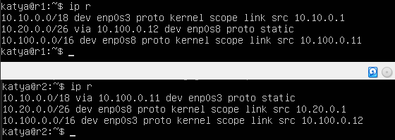    
ip r на обоих роутерах.

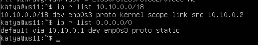    
ip r list 10.10.0.0/[маска сети] и ip r list 0.0.0.0/0 на ws11.

- 10.10.0.0/18 соответствует адресу текущей сети, соответственно направляется напрямую, а 0.0.0.0/0 соответствует default поэтому направлен на указанный в настройках шлюз.

### 5.5. Построение списка маршрутизаторов

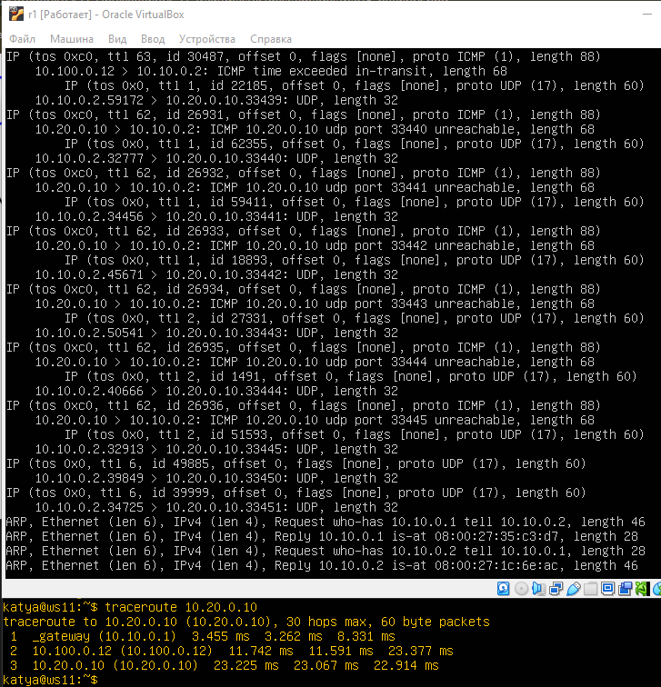    
tcpdump -tnv -i enp0s3 на r1 и traceroute на ws11 к ws21

- traceroute сначало отправляет один пакет с полем TTL = 1, который совершает один прыжок (hop) и достигает ближайшего маршрутизатора. Далее  маршрутизатор уменьшает 1 до нуля и отбрасывает пакет, возвращая сообщение типа "TTL expired in transit" (ICMP Time Exceeded). Далее из полученного сообщения traceroute извлекает IP-адрес маршрутизатора и отображает его в выводе первой строки. Затем повторяется процесс отправки нового пакета, но теперь с увеличенным значением TTL (TTL=2). Пройдя первый маршрутизатор, пакет доходит до второго, где снова уменьшается TTL до нуля, вызывая возврат аналогичного ICMP-сообщения. Таким образом определяется следующий маршрутизатор. Далее пакет достигнет целевого хоста. 

### 5.6. Использование протокола ICMP при маршрутизации

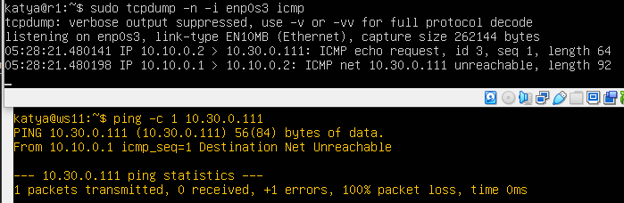    
пинг несуществующего IP с ws11

## Part 6. Динамическая настройка IP с помощью DHCP

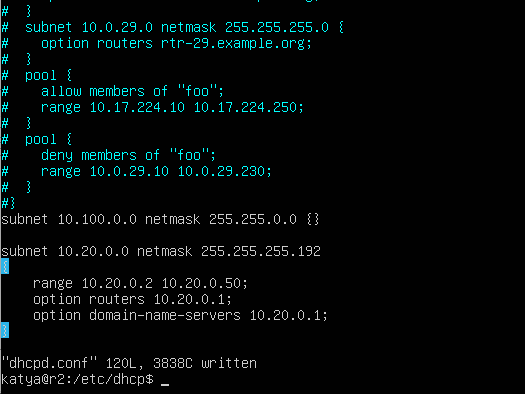   
измененный файл /etc/dhcp/dhcpd.conf у r2

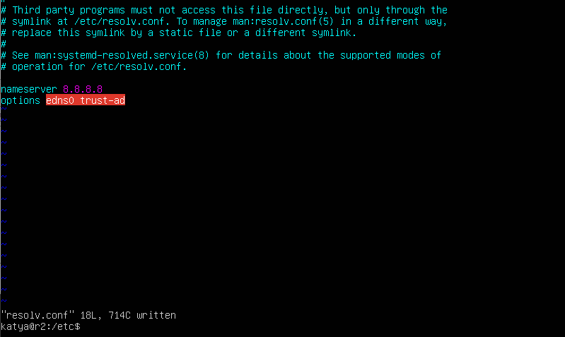   
измененный файл /etc/resolv.conf у r2

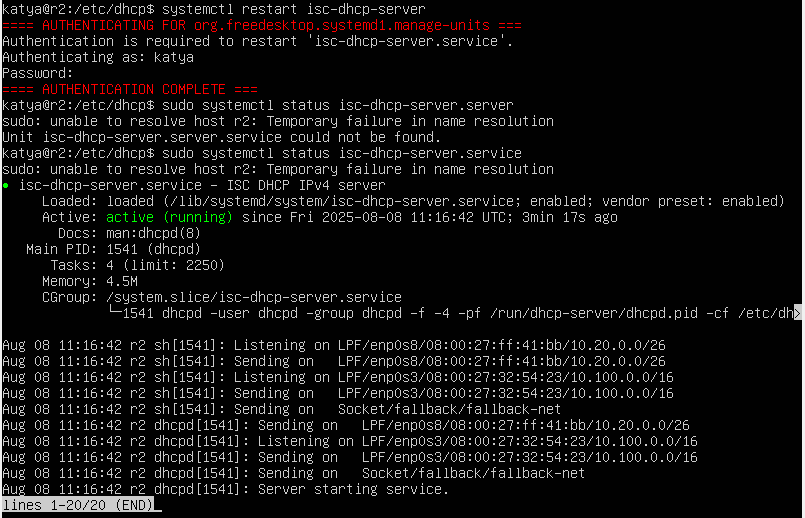   
перезагрузка DHCP командой systemctl restart isc-dhcp-server на r2

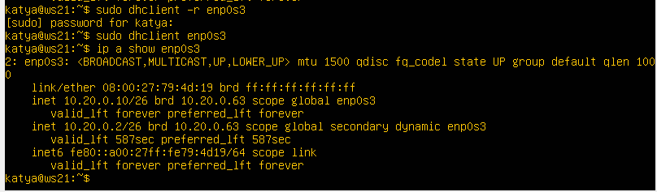   
настройка (после перезагрузки - reboot) командами sudo dhcpclient -r enp0s3 (удаляет адрес интерфейса) и sudo dhcpclient enp0s3 (задает новый адрес интерфейсу) и вывод данного интерфейса через ip a show

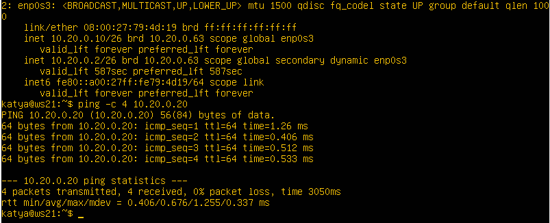   
после этого - пропингован ws22 с ws21

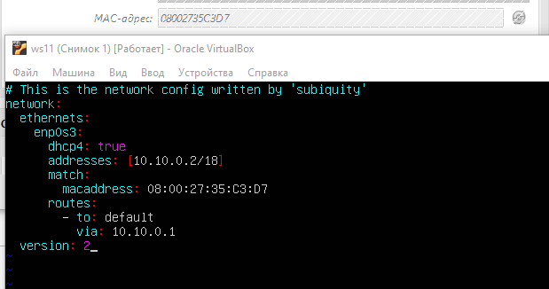   
указан MAC адрес для ws11, dhcp4: true

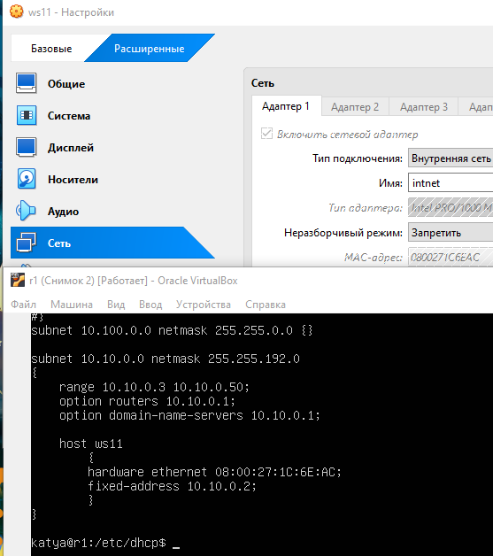   
измененный файл /etc/dhcp/dhcpd.conf у r1

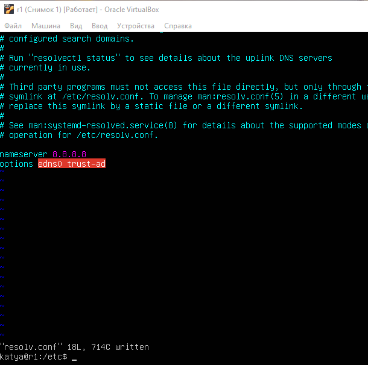   
измененный файл /etc/resolv.conf у r1

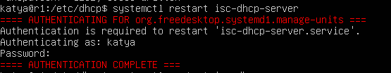   
перезагрузка DHCP командой systemctl restart isc-dhcp-server на r1

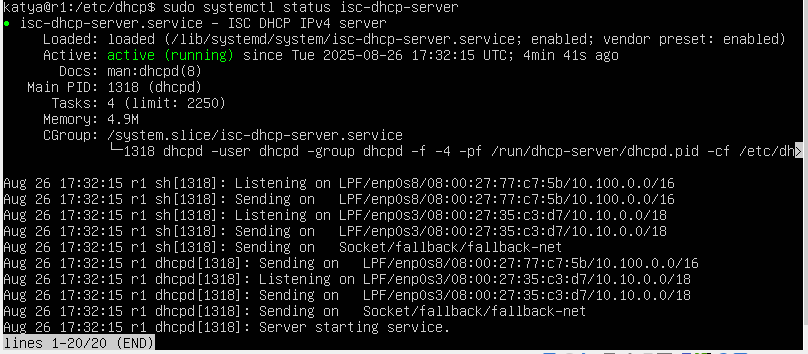   
проверка статуса

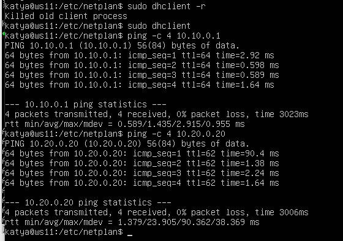   
проверки работы с ws11

## Part 7. NAT

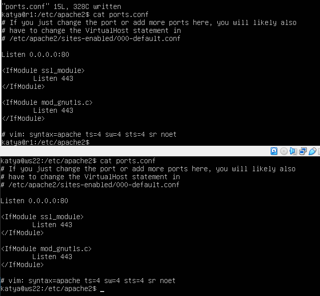   
изменение Listen 0.0.0.0:80 в файле  /etc/apache2/ports.conf

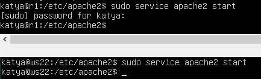   
запуск Apache командой service apache2 start

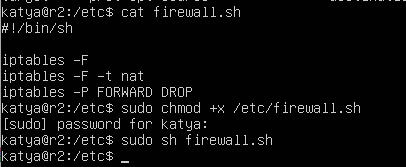   
на r2 создан и запущен фаервол, в котором добавлены следующие правила:
1) Удаление правил в таблице filter — iptables -F;
2) Удаление правил в таблице «NAT» — iptables -F -t nat;
3) Отбрасывать все маршрутизируемые пакеты — iptables --policy FORWARD DROP.

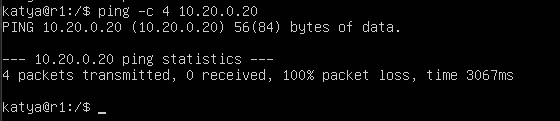   
после запуска фаервола, ws22 не пингуется с r1

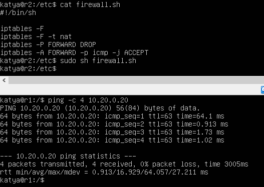   
добавлено правило о разрешении маршрутизации всех пакетов протокола ICMP, теперь ws22 пингуется с r1

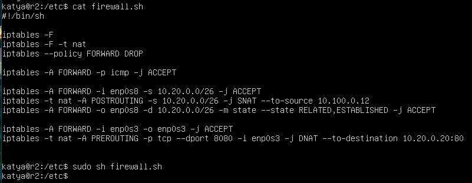   
добавлено маскирование всех локальных IPиз локальной сети, находящейся за r2(включен SNAT), а так же включен  DNAT на 8080 порт машины r2 и добавлен к веб-серверу Apache, запущенному на ws22, доступ извне сети

   
проверено соединение по TCP для SNAT: подключение с ws22 к серверу Apache на r1 командой telnet

   
проверено соединение по TCP для DNAT: подключение с r1 к серверу Apache на ws22 командой telnet (по адресу r2)
